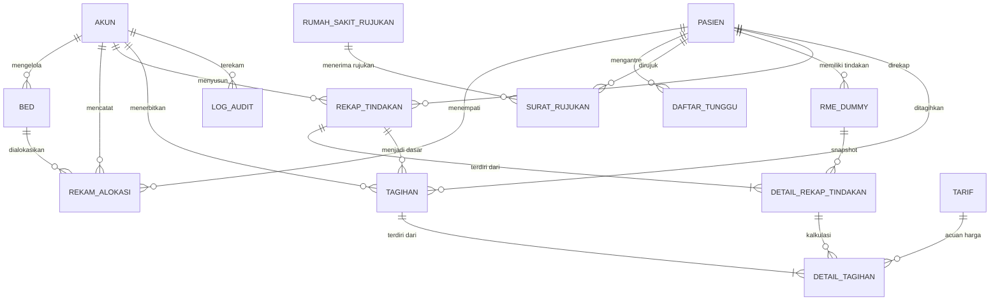

# Product Requirements Document (PRD)

# Sistem Informasi Rawat Inap (Inpatient Care System) - Kelompok 5
**Status Implementasi:** 100% Selesai & Terverifikasi (Production-Ready)  
**Versi Dokumen:** 2.0 (Revisi Final Terintegrasi Figma & Full-Stack Backend)  
**Terakhir Diperbarui:** November 2026

---

## 1. Informasi Proyek & Konsep "Monorepo Satu Folder" (Unified Workspace)

### 1.1 Informasi Umum & Anggota Tim

- **Nama Sistem:** Inpatient Care Information System (SIMRS Rawat Inap Terpadu)
- **Mata Kuliah:** Praktikum Rekayasa Sistem Informasi (RSI - C) — Universitas Brawijaya
- **Tim Pengembang (Kelompok 5):**
  1. **Nawira (N - 255150401111053):** UC-01 (*Login RBAC*) & UC-07 (*Rekap Riwayat Layanan & Tindakan*)
  2. **Muhamad Yusuf Zaki (MYZ - 255150400111064):** UC-02 (*Pengelolaan Data & Ketersediaan Bed*) & UC-03 (*Alokasi Kamar/Bed Pasien*)
  3. **Eugenius Satrio Bagus N. (ESBN - 255150400111021):** UC-04 (*Daftar Tunggu FIFO*), UC-05 (*Rujukan Pasien Darurat*), & UC-06 (*Pemantauan Status Penanganan*)
  4. **Thoriq Farrel Muhammad (TFM - 255150400111074):** UC-08 (*Perhitungan Biaya Pelayanan*) & UC-09 (*Pemeriksaan & Pengelolaan Tagihan/Billing*)

---

### 1.2 Maksud & Definisi "Backend dan Frontend dalam Satu Folder" (Monorepo Architecture)

Proyek ini menggunakan pendekatan **Monorepo / Unified Repository Workspace**. Maksud dari konsep ini adalah:

1. **Satu Repositori Git & Folder Induk Tunggal (`rsi-inpacient/`):**
   Seluruh aset proyek, baik *Frontend* maupun *Backend*, disimpan dan dikelola bersama di dalam satu repositori yang sama. Tidak ada pemisahan repositori Git menjadi dua proyek independen yang terisolasi.
2. **Pemisahan Peran yang Tegas (*Clear Separation of Concerns*):**
   Meskipun berada dalam satu folder induk, proyek ini **bukan** merupakan aplikasi monolit Next.js di mana API Route Next.js menangani seluruh database. Sebaliknya, proyek memiliki dua folder kerja (*workspaces*) mandiri:
   - **`backend/`:** Layanan REST API berbasis **Node.js + Express.js**, terhubung ke database **MySQL** menggunakan **Prisma ORM 6.19.3**. Backend menerapkan arsitektur **Modular Monolith dengan Feature-Based MVC** (setiap fitur memiliki *controller*, *service*, *model*, dan *validation* masing-masing).
   - **`frontend/`:** Aplikasi antarmuka pengguna berbasis **Next.js 16+ (App Router dengan Turbopack)** dengan **React 19, TypeScript, dan Tailwind CSS**. Frontend bertindak sebagai *Client Consumer* yang mengonsumsi endpoint REST API yang disediakan oleh Backend, didukung oleh *transparent stateful in-memory fallback* untuk demonstrasi offline.
3. **Koordinasi Terpusat melalui `npm workspaces`:**
   Pada file `package.json` di *root folder*, terdapat konfigurasi workspace (`"workspaces": ["backend", "frontend"]`). Ini memungkinkan seluruh dependensi diinstal secara serentak melalui `npm install` dari root, serta memudahkan penulisan skrip otomasi untuk menjalankan frontend dan backend secara berdampingan.

```text
┌────────────────────────────────────────────────────────────────────────┐
│                   ROOT REPOSITORY: rsi-inpacient/                      │
│                                                                        │
│   ┌───────────────────────────┐      HTTP REST API     ┌────────────┐  │
│   │        frontend/          │ ◄────────────────────► │  backend/  │  │
│   │    - Next.js (App Router) │    (Port 3000 -> 5000) │  - Express │  │
│   │    - React 19 + TypeScript│                        │  - Prisma  │  │
│   │    - Tailwind CSS         │                        │  - MySQL   │  │
│   │    (Boundary / UI Figma)  │                        │  (Control  │  │
│   └───────────────────────────┘                        │   & Entity)│  │
│                                                        └────────────┘  │
└────────────────────────────────────────────────────────────────────────┘
```

---

### 1.3 Alasan & Keuntungan Pemilihan Arsitektur Monorepo

1. **Paralelisasi Pengerjaan Anggota Tim:**
   Setiap anggota kelompok bertanggung jawab atas fitur yang telah ditentukan secara *end-to-end* (mulai dari UI frontend hingga logika bisnis dan tabel database backend).
2. **Sinkronisasi Kode & Kontrak Data (API Contract):**
   Perubahan tipe data, nama kolom database, atau struktur endpoint dapat langsung diselaraskan di `frontend/src/types/index.ts` dan schema Prisma backend dalam satu repository, mencegah terjadinya ketidakcocokan versi (*version mismatch*).
3. **Dual-Source Execution Safety:**
   Frontend dilengkapi sistem *dual-source network handler*: jika backend Express aktif di `http://localhost:5000/api`, panggilan HTTP langsung diproses oleh Express + MySQL. Jika server backend sedang nonaktif, frontend beralih secara transparan ke *stateful mock storage* (`frontend/src/lib/mock-fallback.ts`) sehingga antarmuka tetap berjalan mulus tanpa crash saat demonstrasi.

---

### 1.4 Pemetaan Pola Desain Akademik BCE (*Boundary-Control-Entity*)

Pola desain **BCE** dipetakan secara terstruktur ke dalam folder monorepo:

- **Boundary (B) — Antarmuka Pengguna:**
  - **Lokasi:** `frontend/src/app/` dan `frontend/src/components/`
  - **Tanggung Jawab:** Menangani presentasi visual, form input, interaksi pengguna, modal dialog, feedback notifikasi (*toast*), dan navigasi breadcrumb. Boundary berkomunikasi dengan backend melalui panggilan HTTP (*fetch* API client di `frontend/src/lib/api-client.ts`).
  - **Kepatuhan Figma:** Seluruh halaman telah diselaraskan dengan rancangan visual Figma resmi (Node `72:9621` untuk Rekap Layanan dan Node `221:3822` untuk Pembayaran & Billing).
- **Control (C) — Logika Bisnis & Alur Proses:**
  - **Lokasi:** `backend/src/modules/<fitur>/<fitur>.controller.js` dan `<fitur>.service.js`
  - **Tanggung Jawab:** Mengorkestrasi aturan bisnis, memvalidasi input via Zod schema, menjalankan *Sequence Diagram* (`SD-01` s.d. `SD-15`), mengeksekusi *Pseudo-Code* (`PC-01` s.d. `PC-32`), menangani hak akses peran (*Role-Based Access Control*), dan mengelola transaksi ACID.
- **Entity (E) — Akses & Integritas Data:**
  - **Lokasi:** `backend/prisma/schema.prisma` dan `backend/src/modules/<fitur>/<fitur>.model.js`
  - **Tanggung Jawab:** Memodelkan 15 tabel database MySQL, mendefinisikan relasi referensial (Foreign Key), indeks performa, aturan *unique*, *soft delete*, serta pencatatan jejak perubahan ke `log_audit`.

---

## 2. Daftar Use Case, Hak Akses Aktor (RBAC), & Status Kesiapan

Sistem memiliki 2 peran pengguna operasional utama ditambah 1 peran pengelola teknis:
1. **Petugas Bed Management** (Contoh: *Budi Santoso* / username: `budi_bed`)
2. **Petugas Administrasi** (Contoh: *Rina Aprilianti* / username: `rina_adm`)
3. **Super Admin** (Akses teknis untuk seeding data dan pengujian sistem)

| Kode UC | Nama Use Case | Aktor Utama | PIC | Boundary (Next.js App Router) | Control & Entity (Express & Prisma) | Status Frontend | Status Backend |
| :--- | :--- | :--- | :---: | :--- | :--- | :---: | :---: |
| **UC-01** | Login Sesuai Peran (RBAC) | Semua Petugas | **N** | `app/login/page.tsx` | `modules/auth/` (`Akun`) | **100% Selesai** | **100% Selesai** |
| **UC-02** | Pengelolaan Data & Ketersediaan Bed | Petugas Bed Management | **MYZ** | `app/(dashboard)/bed-management/page.tsx` | `modules/bed/` (`Bed`) | **100% Selesai** | **100% Selesai** |
| **UC-03** | Alokasi Kamar/Bed kepada Pasien | Petugas Administrasi | **MYZ** | `app/(dashboard)/bed-management/alokasi/page.tsx` | `modules/allocation/` (`Bed`, `RekamAlokasi`, `Pasien`) | **100% Selesai** | **100% Selesai** |
| **UC-04** | Daftar Tunggu Pasien Stabil (FIFO) | Petugas Administrasi | **ESBN** | `app/(dashboard)/sistem-antrian/daftar-tunggu/page.tsx` | `modules/queue/` (`DaftarTunggu`, `Pasien`) | **100% Selesai** | **100% Selesai** |
| **UC-05** | Rujukan Pasien Darurat (SPGDT) | Petugas Administrasi / Medis | **ESBN** | `app/(dashboard)/sistem-antrian/rujukan-pasien/page.tsx` | `modules/referral/` (`SuratRujukan`, `RumahSakitRujukan`) | **100% Selesai** | **100% Selesai** |
| **UC-06** | Pemantauan Status Pasien Terintegrasi | Petugas Administrasi / Perawat | **ESBN** | `app/(dashboard)/sistem-antrian/pemantauan-status/page.tsx` | `modules/monitoring/` (`RiwayatStatusPasien`) | **100% Selesai** | **100% Selesai** |
| **UC-07** | Rekap Riwayat Layanan & Tindakan RME | Petugas Administrasi | **N** | `app/(dashboard)/rekap-layanan/...` (5 Sub-Halaman) | `modules/history/` (`RekapTindakan`, `DetailRekap`, `RmeDummy`) | **100% Selesai** (Figma 72:9621) | **100% Selesai** |
| **UC-08** | Perhitungan Otomatis Biaya Pelayanan | Petugas Administrasi | **TFM** | `app/(dashboard)/pembayaran/buat/[idPasien]/page.tsx` | `modules/billing/preview` (`Tarif`, `DetailRekap`) | **100% Selesai** (Figma 221:3822) | **100% Selesai** |
| **UC-09** | Pemeriksaan, Penyesuaian, & Penerbitan Tagihan | Petugas Administrasi | **TFM** | `app/(dashboard)/pembayaran/...` (4 Sub-Halaman & Modals) | `modules/billing/` (`Tagihan`, `DetailTagihan`, `LogAudit`) | **100% Selesai** (Figma 221:3822) | **100% Selesai** |

---

## 3. Tech Stack & Struktur Direktori Monorepo Terkini

### 3.1 Tech Stack Lengkap

#### A. Frontend Workspace (`frontend/`)
- **Framework:** Next.js 16.4.3 (App Router Architecture dengan Turbopack Engine).
- **Library UI:** React 19 dengan TypeScript ketat (`strict: true`).
- **Styling:** Tailwind CSS v4 + token warna Figma Inpatient Care (`#00b89f`, `#0fa18f`, `#0d332f`).
- **Ikonografi:** `lucide-react` (katalog ikon operasional medis modern).
- **Kompatibilitas Prerender:** Mendukung *Static Site Generation* (SSG) dan *Partial Prerendering* (PPR) dengan Suspense boundaries pada seluruh halaman dinamis.
- **Pembersihan UI:** Seluruh label teknis/akademis telah dibersihkan sehingga antarmuka menampilkan nama fitur klinis rumah sakit yang profesional.

#### B. Backend Workspace (`backend/`)
- **Runtime:** Node.js (ES Modules, `"type": "module"`).
- **Framework Web:** Express.js 5.
- **ORM & Database:** Prisma ORM 6.19.3 terhubung ke MySQL 8.
- **Validasi Data:** Zod Schema untuk validasi payload request body, query, dan params.
- **Keamanan:** `cors`, `helmet`, JWT token auth, dan transaksi ACID ber-lock `FOR UPDATE`.

---

### 3.2 Peta Rute Aplikasi Frontend (25 Rute Terverifikasi Build)

```text
frontend/src/app/
├── (auth)/
│   └── login/page.tsx                       # Halaman Login Multi-Role (UC-01)
├── (dashboard)/
│   ├── dashboard/page.tsx                   # Beranda & Metrik Utama Rawat Inap
│   ├── bed-management/
│   │   ├── page.tsx                         # Dashboard Ketersediaan & Master Bed (UC-02)
│   │   └── alokasi/page.tsx                 # Form Alokasi Kamar & Dokter DPJP (UC-03)
│   ├── sistem-antrian/
│   │   ├── page.tsx                         # Pengarah ke Sistem Antrean
│   │   ├── daftar-tunggu/page.tsx           # Antrean FIFO Pasien Kondisi Stabil (UC-04)
│   │   ├── rujukan-pasien/page.tsx          # Sistem Rujukan SPGDT Pasien Darurat (UC-05)
│   │   └── pemantauan-status/page.tsx       # Konsolidasi Status Tracking Pasien (UC-06)
│   ├── rekap-layanan/                       # Modul Rekap Tindakan (UC-07 - Figma 72:9621)
│   │   ├── page.tsx                         # Tabel Rekap, KPI Cards, & Filter Status
│   │   ├── [idRekap]/page.tsx               # Rincian Snapshot Rekap Tindakan
│   │   ├── [idRekap]/edit/page.tsx          # Edit Catatan & Keterangan Rekap
│   │   ├── pasien/[idPasien]/page.tsx       # Riwayat RME Pasien (Read-Only)
│   │   └── pasien/[idPasien]/buat/page.tsx  # Pembuatan Snapshot Rekap Baru
│   ├── pembayaran/                          # Modul Billing (UC-08 & UC-09 - Figma 221:3822)
│   │   ├── page.tsx                         # Dashboard Tagihan, 4 KPI, Filter & Tabel
│   │   ├── buat/page.tsx                    # Alur 1: Pilih Pasien Rekap Siap Billing
│   │   ├── buat/[idPasien]/page.tsx         # Alur 2: Rincian Biaya Pelayanan (UC-08)
│   │   ├── buat/[idPasien]/pemeriksaan/page.tsx # Alur 3: Pemeriksaan & Hitung Ulang (UC-09)
│   │   ├── buat/[idPasien]/penerbitan/page.tsx  # Alur 4: Terbitkan Invoice Resmi & Cetak
│   │   └── [idTagihan]/page.tsx             # Detail Tagihan, Histori Audit, & Modal Status
│   ├── pengaturan/page.tsx                  # Simulasi Peran Petugas & Reset Data Demo
│   └── bantuan/page.tsx                     # Pusat Bantuan & Panduan SOP Operasional (01-09)
```

---

## 4. Skema Database Relasional (15 Tabel MySQL)

Hubungan antar-entitas data dimodelkan secara terintegrasi pada Prisma ORM:



---

## 5. Spesifikasi Alur Bisnis & Kepatuhan Desain Figma Terkini

### 5.1 Modul Rekap Layanan & Tindakan Pasien (UC-07)
*Kepatuhan Penuh terhadap Figma URL Node `72:9621`*

1. **Dashboard Rekapitulasi (`/rekap-layanan`):**
   - Header enterprise: Title `Rekap Layanan & Tindakan`, subheader `Kelola dan verifikasi riwayat layanan pasien untuk kebutuhan billing.`.
   - **4 KPI Cards:** *Total Rekap*, *Draft*, *Verifikasi*, *Siap Billing* dilengkapi indikator warna dan chevron.
   - **Tabel Rekapitulasi:** Kolom nomor, kode rekap (`RKP-YYYYMMDD-XXX`), inisial avatar & nama pasien, nomor RM, jumlah tindakan, status badge pill, waktu pembaruan, dan aksi (*Lihat Detail*, *Edit*, *Hapus*).
   - **Proteksi Integritas Hapus:** Rekap yang telah memiliki tagihan aktif di modul pembayaran **tidak dapat dihapus**, memunculkan modal peringatan penolakan untuk menjaga integritas data keuangan.
2. **Riwayat RME Pasien (`/rekap-layanan/pasien/[idPasien]`):**
   - Menampilkan catatan elektronik RME read-only dari dokter dan perawat, badge kategori tindakan, dan tombol cepat pembuatan snapshot rekap baru.
3. **Form Pembuatan Snapshot (`/rekap-layanan/pasien/[idPasien]/buat`):**
   - Menarik seluruh tindakan aktif pasien dari `rme_dummy`, mengunci data menjadi snapshot `detail_rekap_tindakan` dengan status awal `Draft`.
4. **Detail & Edit Rekap (`/rekap-layanan/[idRekap]` & `edit`):**
   - Meninjau komponen layanan medis dan merubah status: `Draft` $\rightarrow$ `Proses Verifikasi` $\rightarrow$ `Siap Billing`.
   - Hanya dokumen berstatus `Siap Billing` yang dapat ditarik untuk kalkulasi biaya tagihan.

---

### 5.2 Modul Perhitungan Biaya & Pengelolaan Tagihan (UC-08 & UC-09)
*Kepatuhan Penuh terhadap Figma URL Node `221:3822`*

1. **Dashboard Billing & Manajemen Tagihan (`/pembayaran`):**
   - Header enterprise: Title `Pembayaran & Tagihan Pasien`, subheader `Kelola perhitungan biaya, penerbitan invoice, dan status pembayaran pasien rawat inap.`.
   - **4 Financial KPI Cards:**
     - *Total Tagihan* (`bg-[#e7faf7] text-[#00b89f]`): Seluruh invoice terdaftar.
     - *Belum Dibayar* (`bg-[#fef3e9] text-[#e06a14]`): Tagihan yang perlu ditindaklanjuti.
     - *Lunas* (`bg-[#e6f4ef] text-[#016b46]`): Pembayaran yang telah diselesaikan.
     - *Dibatalkan* (`bg-[#fdf0f0] text-[#dc2626]`): Invoice yang di-soft delete dengan alasan resmi.
   - **Filter & Toolbar:** Input pencarian pasien/RM/invoice, range picker tanggal (`01–28 Feb 2026`), dropdown status, tombol cari toska, dan tab status interaktif (*Semua*, *Belum Dibayar*, *Lunas*, *Batal*).
   - **Modal Master Tarif:** Menampilkan katalog referensi harga pelayanan per kategori dan tanggal berlaku.
2. **Alur Buat Tagihan 1: Pilih Pasien (`/pembayaran/buat`):**
   - Menampilkan pasien rawat inap. **Aturan Bisnis:** Hanya pasien dengan rekap berstatus `Siap Billing` yang tombol *Pilih Pasien*-nya aktif. Pasien dengan status lain atau tagihan sudah terbit otomatis dinonaktifkan (*disabled*).
3. **Alur Buat Tagihan 2: Rincian Biaya Pelayanan / UC-08 (`/pembayaran/buat/[idPasien]`):**
   - Perhitungan otomatis berdasarkan data rekap dan master tarif yang berlaku.
   - Tabel rincian layanan: Akomodasi kamar, konsultasi dokter spesialis, laboratorium, tindakan medis, keperawatan dengan jumlah hari/kali, harga satuan, dan subtotal.
   - Kotak ringkasan total biaya layanan dan navigasi ke tahapan pemeriksaan.
4. **Alur Buat Tagihan 3: Pemeriksaan & Penyesuaian Tagihan / UC-09 (`/pembayaran/buat/[idPasien]/pemeriksaan`):**
   - Layout 2 kolom: Informasi pasien, tabel rincian, dan form catatan penyesuaian audit di sisi kiri.
   - Kolom kanan: Ringkasan total biaya, status `Menunggu verifikasi`, tombol **Hitung Ulang** (*Recalculate* yang memanggil API recalculate), dan tombol **Konfirmasi Tagihan Sesuai**.
5. **Alur Buat Tagihan 4: Penerbitan Invoice Resmi (`/pembayaran/buat/[idPasien]/penerbitan`):**
   - Banner verifikasi sukses dan lembar invoice cetak resmi (Kop RS INPATIENT CARE, nomor invoice otomatis, tabel layanan, catatan penyesuaian, petugas verifikator, dan total tagihan berlatar gelap).
   - Tombol **Pratinjau Cetak** dan tombol **Terbitkan Invoice** dengan pop-up modal **Konfirmasi Penerbitan Invoice**.
6. **Detail & Kelola Tagihan (`/pembayaran/[idTagihan]`):**
   - Tampilan rincian tagihan tersimpan dan timeline **Histori Aktivitas** (jejak audit penerbitan, pelunasan, atau pembatalan).
   - Modal **Ubah Status Pembayaran** (pilihan radio *Belum Dibayar* vs *Lunas*).
   - Modal **Batalkan Tagihan?** (wajib mengisi alasan pembatalan maksimal 200 karakter, dicatat ke `log_audit`).

---

## 6. Panduan Menjalankan Sistem & Verifikasi Build

### 6.1 Instalasi & Persiapan Lingkungan

Jalankan perintah berikut pada root folder repositori `rsi-inpacient/`:

```powershell
# 1. Instal seluruh dependensi root, backend, dan frontend
npm install

# 2. Setup environment backend (port 5000)
Copy-Item backend/.env.example backend/.env
```

Contoh konfigurasi `backend/.env`:
```dotenv
PORT=5000
NODE_ENV=development
DATABASE_URL="mysql://root:@127.0.0.1:3306/inpatient_db"
JWT_SECRET="rahasia_jwt_kelompok_5_inpatient_care"
FRONTEND_ORIGIN="http://localhost:3000"
```

### 6.2 Menjalankan Aplikasi Secara Bersamaan

- **Terminal 1 — Backend Express REST API:**
  ```powershell
  cd backend
  npm run dev
  # Berjalan pada http://localhost:5000
  # Health check: http://localhost:5000/api/health
  ```

- **Terminal 2 — Frontend Next.js Web Application:**
  ```powershell
  cd frontend
  npm run dev
  # Berjalan pada http://localhost:3000
  ```

---

### 6.3 Hasil Verifikasi Kompilasi Produksi (`npm run build`)

Pengujian build dilakukan pada workspace `frontend` dengan hasil sempurna tanpa error:

```bash
> inpatient-care@0.1.0 build
> next build

▲ Next.js 16.4.3 (Turbopack)
✓ Running next.config.ts took 40ms
- Cache Components enabled
- Partial Prefetching enabled
✓ Compiled successfully in 1035ms
✓ Running TypeScript ... Finished in 3.3s (0 errors)
✓ Generating static pages using 11 workers (25/25) in 1588ms
✓ Finalizing page optimization ...
Command exited with code 0.
```

Seluruh 25 rute frontend terkompilasi dalam mode Static & Partial Prerendering (PPR) dan siap digunakan untuk demonstrasi akademik maupun implementasi operasional rumah sakit.
